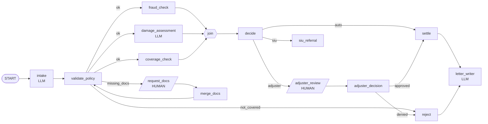

# adk-insurance-claims-workflow

An insurance claim processor built as a **Google ADK graph workflow**, with a live web UI that shows the graph executing step by step.

You describe a claim in plain English. The workflow extracts the details, validates the policy, runs fraud, damage and coverage checks in parallel, and routes the claim to auto-approval, a human adjuster, or a fraud investigation unit (SIU). It finishes by writing a letter to the policyholder.

## Why ADK workflows?

A single LLM agent with tools is good at open-ended tasks. Business processes like claims are different: the steps, branches and approvals are known in advance, and you need them to run the same way every time. ADK workflows let you define that process as an explicit graph.

| Need | What a workflow gives you |
|---|---|
| **Predictable control flow** | You decide the order of steps and the branches. The LLM does not decide whether a fraud check runs, so a $20k claim can't skip approval. |
| **Right tool for each step** | One graph mixes LLM agents (extraction, estimation, writing) with plain Python functions (rules, lookups, math). Use an LLM only where judgment or language is needed. |
| **Conditional routing** | A node returns a route (`ok`, `missing_docs`, `siu`, ...) and ADK follows the matching edge. Business rules stay in code, not in a prompt. |
| **Parallelism** | Fan out to several nodes at once and merge them with a `JoinNode`. Fraud, damage and coverage checks run concurrently. |
| **Loops and retries** | Edges can point backwards. Here a claim that is missing documents loops back to validation, with a cap of two requests. |
| **Human-in-the-loop** | A node can yield a `RequestInput` and the workflow pauses, keeping its state, until a person replies. No custom pause and resume plumbing. |
| **Observability and testing** | Every node emits an event with its output and route. You can see exactly what ran and why, and test each node in isolation. |
| **Fewer tokens, lower cost and latency** | Deterministic nodes cost nothing to run, and each LLM node gets a small, focused prompt instead of one long prompt that handles everything. |

## The workflow



**Business rules** (in `claims_agent/agent.py`):
- A policy that is inactive or doesn't cover the incident type is rejected.
- Missing required documents trigger a human request, up to 2 times. After that the claim is rejected.
- High fraud risk goes to SIU. Medium risk, or a payout over $5,000, needs adjuster approval. Everything else is auto-approved.
- Payout = min(damage estimate, policy limit) - deductible.

## ADK concepts used, and where

| Concept | Where in the code |
|---|---|
| `Workflow` with `edges=[...]` | `root_agent` at the bottom of `claims_agent/agent.py` |
| LLM nodes (`Agent` with `output_schema`) | `intake`, `damage_assessment`, `letter_writer` |
| Function nodes | `validate_policy`, `fraud_check`, `decide`, `settle`, ... |
| Routing (`Event(route=...)`, routing maps) | `validate_policy`, `decide`, `adjuster_decision` |
| Parallel fan-out and `JoinNode` | `(fraud_check, damage_assessment, coverage_check)` into `join` |
| Loop | `request_docs` -> `merge_docs` -> `validate_policy` |
| Human-in-the-loop (`RequestInput`) | `request_docs`, `adjuster_review` |
| Workflow state (`ctx.state`, `Event(state=...)`) | `claim`, `decision`, `missing`, `doc_requests` |

One thing to know: when a human replies to a `RequestInput`, ADK does not re-run the waiting node. The reply becomes that node's output. That is why each human step is followed by a small function node (`merge_docs`, `adjuster_decision`) that uses the reply.

## Run it

Requires Python 3.10+ and a Gemini API key.

```powershell
python -m venv .venv
.\.venv\Scripts\python -m pip install -r requirements.txt
$env:GOOGLE_API_KEY = "<your key>"      # or put it in a .env file
.\.venv\Scripts\python server.py        # open http://127.0.0.1:8000
```

Always use the venv's executables. A globally installed `adk` may be an older version without `Workflow` and can fail with protobuf errors.

### The demo UI
- Pick a scenario or type your own claim. Mention a policy ID such as `POL-1001`, what happened, the amount, and the documents you are attaching.
- The graph is read from the real ADK workflow. Nodes pulse while running and turn green when done, and the edges that were taken light up.
- When the workflow pauses for a human, an amber panel appears so you can supply documents or approve or deny the payout.
- The timeline lists each step with a summary. Click an entry for its raw output. The result card shows the outcome and the letter.

Preset scenarios:

| Scenario | Path through the graph |
|---|---|
| Fender bender | Straight through to auto-approve |
| Kitchen flood | Missing-document loop, then adjuster approval |
| Suspicious theft | Fraud flagged, referred to SIU |
| Lapsed policy | Rejected at validation |
| Not covered | Rejected, incident type not covered |

### Other ways to run it
- `.\.venv\Scripts\adk.exe web` opens the standard ADK dev UI. Pick `claims_agent`.
- `.\.venv\Scripts\python run_demo.py [small|large|fraud]` runs headless in the terminal and answers the human steps automatically.

## Project layout

```
claims_agent/
  agent.py     the workflow graph (root_agent)
  data.py      mock policies, required documents, claim history
server.py      FastAPI server: runs the workflow, streams events (SSE) to the UI
static/
  index.html   live graph, timeline, human-input panel
run_demo.py    headless CLI runner
```

## How the UI talks to ADK

`server.py` runs `root_agent` with ADK's `InMemoryRunner`. It relays each ADK event (node name, output, route) to the browser over Server-Sent Events. Human replies go back as ADK function responses, which resume the paused workflow. The server adds no orchestration of its own.

The graph drawing comes from `root_agent.graph`. The "running" highlight is the UI's own inference from the edges, since ADK only emits an event when a node finishes.

## Make it your own

- **Change the rules:** edit thresholds and checks in `claims_agent/agent.py` (`AUTO_APPROVE_LIMIT`, `MAX_DOC_REQUESTS`, the fraud signals).
- **Add data:** edit `claims_agent/data.py` to add policies or required documents.
- **Add a node:** write a function or `Agent`, add it to `edges`, and give it a position in `LAYOUT` in `static/index.html`.

All data is mocked. A real system would replace `data.py` with calls to a policy system, a claims history service and a fraud model.
